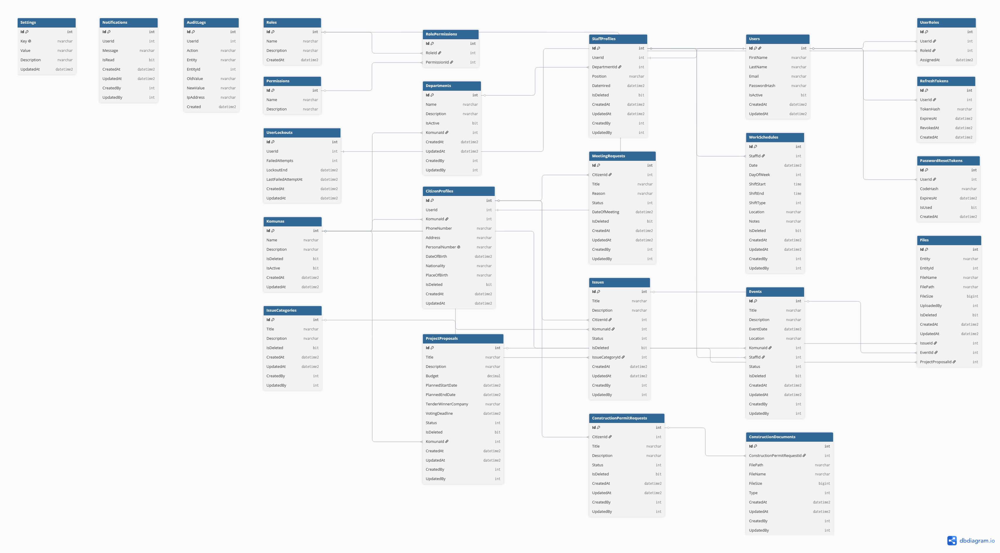

# 🏛️ MyTown

A modern municipal management platform designed to improve communication between citizens and local government institutions.

MyTown enables citizens to report issues, submit project proposals, request meetings with municipal officials, receive notifications, and stay informed about local events. The platform also provides municipal staff and administrators with tools to efficiently manage departments, events, citizen concerns, and public services.

---

# 📚 Table of Contents

* Overview
* Key Features
* Technology Stack
* System Architecture
* Project Structure
* Setup Guide
* API Endpoints
* Database Design
* Real-Time Communication
* Security
* Future Improvements

---

# 🌟 Overview

MyTown is a web-based municipal management system that aims to increase transparency, citizen engagement, and efficiency within local government operations.

The platform provides a centralized environment where:

* Citizens can post issues on their town.
* Municipal staff can manage meetings requests, manage issues, manage history, publish events.
* Administrators can monitor and control system activities.
* Public information is distributed efficiently through events and notifications.

---

# 🚀 Key Features

## 🔐 Authentication & Authorization

* User Registration
* User Login
* JWT Authentication
* Refresh Token Mechanism
* Password Recovery
* Password Reset
* Role-Based Access Control (RBAC)
* Permission-Based Authorization
* Advanced Search
* Data Exchange

---

## 🔍 Advanced Search

- Search Issues
- Search Citizens
- Search Staff
- Search Departments
- Search Meeting Requests

---

## 🔄 Data Import & Export

- Export data to CSV
- Export data to Excel
- Export data to JSON
- Import data from CSV
- Import data from Excel
- Import data from JSON

---

## 🪪 ID Document Scanning

- Upload ID card
- OCR Extraction
- Automatic citizen information processing
- Reduced manual data entry

---

## 🏢 Department Management

* Create Departments
* Manage municipal departments
* Assign staff to departments
* Update and delete departments
* Administrative Audit Tracking

---

## 🏛️ Municipality Management

* Create Municipality Information
* Edit Municipality Information
* Delete Municipality Records
* Public Municipality Information Access

---

## 👨‍💼 Staff Management

- Create staff profiles
- Update staff information
- Delete staff records
- Department assignment

---

## 📅 Work Schedule Management

- Create schedules
- Update schedules
- Delete schedules
- Monitor staff availability
- View assigned schedules

---

## 🚨 Issue Reporting System

Citizens can:

* Report municipal issues
* Upload supporting files/images
* Track issue status
* Interact with community reports

Municipal Staff can:

* Review reported issues
* Update issue status
* Resolve citizen complaints

---

## 🏷️ Issue Categories

Administrators can:

* Create issue categories
* Update categories
* Delete categories

Citizens can:

* Browse available issue categories

---

## 👍 Issue Interactions

Citizens can:

Like reported issues
Add comments
Participate in discussions
View community feedback

---

## 📅 Events Management

* Publish municipal events
* Upload event images
* Update event information
* Delete events
* Notify citizens instantly

Citizens can:

* View upcoming events
* Interact with events through reactions

---

## 😊 Event Reactions

Citizens can:

* React to municipal events
* View community engagement statistics

---

## 🤝 Meeting Requests

Citizens can:

* Request meetings with municipal officials
* Track request status

Municipal Staff can:

* Review meeting requests
* Approve or reject requests
* Manage scheduling


---

## 🏗 Construction Permit Requests

 Citizens can:

- Submit permit requests
- Upload construction documents
- Track approval status
- Staff review workflow

Municipal Staff can:

- Review permit applications
- Update request status
- Upload approval or rejection documents

---

## 👍 Community Engagement

- Like municipal issues
- Comment on issues
- React to public events
- Vote on project proposals

---

## 💡 Project Proposals

Citizens can:

* Submit development proposals
* Upload supporting documents

Municipal Staff can:

* Review proposals
* Update proposals
* Delete proposals

---

## 🗳️ Proposal Voting System

Citizens can:

* Vote on public project proposals
* Change their vote
* View real-time voting results

---

## 🔔 Notification System

* User Notifications
* Read/Unread Tracking
* Mark Individual Notifications
* Mark All Notifications

---

## 📜 Municipality History

- View historical records
- Filter by date
- Export reports to PDF

---

# 🛠 Technology Stack

| Layer                   | Technology             |
| ----------------------- | ---------------------- |
| Frontend                | React                  |
| Backend                 | ASP.NET Core Web API   |
| Authentication          | JWT Bearer Tokens      |
| Database                | SQL Server             |
| NoSQL Database          | MongoDB                |
| ORM                     | Entity Framework Core  |
| Real-Time Communication | SignalR                |
| Architecture            | Hexagonal Architecture |
| Validation              | FluentValidation       |
| Dependency Injection    | Built-in .NET DI       |
| API Documentation       | Swagger                |

---

# 🏗 System Architecture

The project follows the Hexagonal Architecture (Ports & Adapters) pattern.

This architecture separates business logic from external technologies, making the system easier to maintain, test, and extend.

## Core Layers

### API Layer

Responsible for:

* Controllers
* Authentication
* Request handling
* HTTP responses

### Application Layer

Contains:

* DTOs
* Services
* Validators
* Inbound Ports
* Outbound Ports
* Application Logic

### Domain Layer

Contains:

* Entities
* Enums
* Business Rules
* Shared Components

### Infrastructure Layer

Contains:

* Persistence
* Entity Framework Configurations
* SQL Server Access
* MongoDB Access
* Migrations
* Seed Data
* External Services

---

# 📂 Project Structure

```text
MyTown

├── FrontEnd
│   └── src
│       ├── api
│       ├── components
│       ├── layouts
│       ├── dashboards
│       ├── pages
│       └── services
│
├── BackEnd
│
│   ├── API
│   │   ├── Controllers
│   │   ├── Images
│   │   └── Program.cs
│   │
│   ├── Application
│   │   ├── DTOs
│   │   ├── Services
│   │   ├── Validators
│   │   ├── InboundPorts
│   │   ├── OutboundPorts
│   │   └── Settings
│   │
│   ├── Domain
│   │   ├── Entities
│   │   ├── Enums
│   │   ├── Common
│   │
│   └── Infrastructure
│       ├── Persistence
│       ├── Migrations
│       ├── Data
│       ├── Mongo
│       ├── SeedData
│       └── Services
```

# 📡 API Endpoints

## Authentication

| Endpoint                  | Method | Description              |
| ------------------------- | ------ | ------------------------ |
| /api/auth/register        | POST   | Register new user        |
| /api/auth/login           | POST   | Login user               |
| /api/auth/refresh         | POST   | Refresh token            |
| /api/auth/forgot-password | POST   | Request password reset   |
| /api/auth/reset-password  | POST   | Reset password           |
| /api/auth/me              | GET    | Current user information |
| /api/auth/logout          | POST   | Logout user              |


## Advanced Search

| Endpoint                            | Method |
| --------------------                | ------ |
| /api/AdvancedSearch/issues          | GET    |
| /api/AdvancedSearch/departments     | GET    |
| /api/AdvancedSearch/meetingRequests | GET    |
| /api/AdvancedSearch/citizens        | GET    |
| /api/AdvancedSearch/staff           | GET    |


## Data Exchange
### Export Data

| Endpoint                                      | Method |
| --------------------                          | ------ |
| /api/DataExchange/export/{entityType}/format  | GET    |

Supported formats:
* CSV
* Exel
* Json

### Import Data

| Endpoint                                      | Method |
| --------------------                          | ------ |
| /api/DataExchange/import/{entityType}/format  | POST   |

Supported formats:
* CSV
* Exel
* Json

## Departments

| Endpoint             | Method |
| -------------------- | ------ |
| /api/department      | GET    |
| /api/department/{id} | GET    |
| /api/department      | POST   |
| /api/department/{id} | PUT    |
| /api/department/{id} | DELETE |


## Construction Permit Requests

| Endpoint | Method |
|-----------|---------|
| /api/constructionpermitrequest | GET |
| /api/constructionpermitrequest/{id} | GET |
| /api/constructionpermitrequest | POST |
| /api/constructionpermitrequest/{id} | PUT |
| /api/constructionpermitrequest/{id}/documents | PUT |
| /api/constructionpermitrequest/{requestId} | DELETE |


## Staff

| Endpoint | Method |
|-----------|---------|
| /api/staff | GET |
| /api/staff/{id} | GET |
| /api/staff | POST |
| /api/staff/{id} | PUT |
| /api/staff/{id} | DELETE |

## Citizen

| Endpoint            | Method |
| ------------------- | ------ |
| /api/citizen        | GET    |
| /api/citizen/{id}   | GET    |
| /api/citizen        | POST   |
| /api/citizen/{id}   | PUT    |
| /api/citizen/{id}   | DELETE |

## Komuna

| Endpoint                | Method |
| ----------------------- | ------ |
| /api/komuna             | GET    |
| /api/komuna/{id}        | GET    |
| /api/komuna             | POST   |
| /api/komuna/{id}        | PUT    |
| /api/komuna/{id}        | DELETE |


## Work Schedule

| Endpoint | Method |
|-----------|---------|
| /api/workschedule | GET |
| /api/workschedule/{id} | GET |
| /api/workschedule | POST |
| /api/workschedule/{id} | PUT |
| /api/workschedule/{id} | DELETE |

## ID Scan

| Endpoint | Method |
|-----------|---------|
| /api/id-scan/extract | POST |

## History

| Endpoint | Method |
|-----------|---------|
| /api/history | GET |
| /api/history/export-pdf | GET |

## Events

| Endpoint         | Method |
| ---------------- | ------ |
| /api/events      | GET    |
| /api/events/{id} | GET    |
| /api/events      | POST   |
| /api/events/{id} | PUT    |
| /api/events/{id} | DELETE |

## Event Reactions

| Endpoint                                | Method |
| --------------------------------------- | ------ |
| /api/events/{eventId}/reactions         | GET    |
| /api/events/{eventId}/reactions         | POST   |

## Issues

| Endpoint                 | Method |
| ------------------------ | ------ |
| /api/issues              | GET    |
| /api/issues/{id}         | GET    |
| /api/issues              | POST   |
| /api/issues/{id}/details | PUT    |
| /api/issues/{id}/status  | PATCH  |
| /api/issues/{id}         | DELETE |

## Issue Categories

| Endpoint                 | Method |
| ------------------------ | ------ |
| /api/issuecategory       | GET    |
| /api/issuecategory/{id}  | GET    |
| /api/issuecategory       | POST   |
| /api/issuecategory/{id}  | PUT    |
| /api/issuecategory/{id}  | DELETE |

## Issue Interactions

| Endpoint                               | Method |
| -------------------------------------- | ------ |
| /api/issues/{issueId}/likes            | GET    |
| /api/issues/{issueId}/likes/toggle     | POST   |
| /api/issues/{issueId}/comments         | GET    |
| /api/issues/{issueId}/comments         | POST   |

## Meeting Requests

| Endpoint                 | Method |
| ------------------------ | ------ |
| /api/meetingrequest      | GET    |
| /api/meetingrequest      | POST   |
| /api/meetingrequest/{id} | PUT    |
| /api/meetingrequest/{id} | DELETE |

## Project Proposals

| Endpoint                  | Method |
| ------------------------- | ------ |
| /api/projectproposal      | GET    |
| /api/projectproposal/{id} | GET    |
| /api/projectproposal      | POST   |
| /api/projectproposal/{id} | PUT    |
| /api/projectproposal/{id} | DELETE |

## Votes

| Endpoint                               | Method |
| -------------------------------------- | ------ |
| /api/votes/{projectProposalId}/vote    | POST   |
| /api/votes/{projectProposalId}         | GET    |

## Notifications

| Endpoint                    | Method |
| --------------------------- | ------ |
| /api/notification           | GET    |
| /api/notification/{id}/read | PUT    |
| /api/notification/read-all  | PUT    |

---
## Installation

### Clone Repository

```bash
git clone https://github.com/YourUsername/MyTown.git
```

### Backend

```bash
cd Backend
dotnet restore
dotnet run
```

### Frontend

```bash
cd FrontEnd
npm install
npm run dev
```


---
# 🗄 Database Design

The MyTown platform uses a relational SQL Server database designed around municipalities, citizens, staff management, issue reporting, events, project proposals, notifications, and authorization.

## Entity Relationship Diagram (ERD)
<p align="center">
  <a href="./docs/ERD.png">
    
  </a>
</p>

Click the diagram to view it in full size.

## Main Entities


* Users
* CitizenProfiles
* Departments
* Events
* Municipalities
* Issues
* IssueCategory
* MyTownFiles
* Meeting Requests
* Project Proposals
* Notifications
* Permissions
* Roles
* RolePermissions
* Settings
* Staff
* UserRoles
* UserLocokut
* WorkSchedule
* RefreshToken
* PasswordReset
* ConstructionPermmitRequest
* ConstructionDocument


## MongoDB

Stores:

* Documents
* Logs
* Non-relational records
* Flexible data structures

---

# ⚡ Real-Time Communication

The platform uses SignalR for real-time updates.

Supported real-time modules:

* Event Publishing Notifications
* Issue Reporting Notifications
* Project Proposal Notifications
* Meeting Requests Notifications


---

# 🔒 Security

* JWT Authentication
* Refresh Tokens
* Role-Based Authorization
* Permission-Based Policies
* Secure Cookies
* Protected API Endpoints

---

# 🚀 Future Improvements

* Mobile Application
* GIS Map Integration
* AI-Powered Issue Classification
* Open Data Portal
* Public Budget Transparency Dashboard
* Multi-Language Support
* Online Municipal Payments

---

# 👨‍💻 Contributors

Lab Course 2 Project

MyTown Development Team:
Shpresim, Rinor, Arlind, Florent

LabCourse Project 2026
